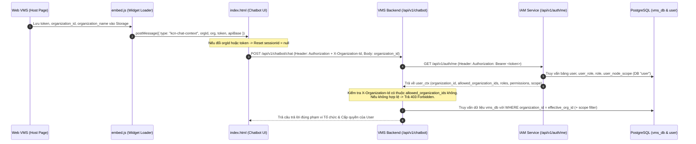

# TÀI LIỆU ĐẶC TẢ TÍCH HỢP CHATBOT: NHẬN DIỆN TỔ CHỨC, MA TRẬN PHÂN QUYỀN & TRUY VẤN SQL DATABASE (KCN HƯNG PHÚ)

> **Phiên bản:** 1.0  
> **Hệ thống:** Smart VMS / IOC KCN Hưng Phú (`smart_vms_dev`)  
> **Mục đích:** Cung cấp đặc tả kỹ thuật đầy đủ cho đội phát triển Chatbot / AI Agent về:
> 1. Cơ chế nhận diện **Chatbot đang chat với Tổ chức nào, Người dùng nào, Vai trò & Phạm vi khu vực nào**.
> 2. **Ma trận phân quyền các cấp** trong KCN Hưng Phú (Cấp hành chính & Cấp bộ phận chuyên môn IOC) — mỗi cấp được phép xem thông tin gì.
> 3. **Danh mục Database, Bảng & Trường (Column) SQL** bắt buộc dùng trong mệnh đề `WHERE` khi truy vấn dữ liệu theo phân quyền.

---

## MỤC LỤC

1. [Tổng quan Kiến trúc & Thông tin Môi trường](#1-tổng-quan-kiến-trúc--thông-tin-môi-trường)
2. [Cơ chế Nhận diện "Chatbot đang chat với Tổ chức nào & Ai" (End-to-End)](#2-cơ-chế-nhận-diện-chatbot-đang-chat-với-tổ-chức-nào--ai-end-to-end)
   - [2.1. Tầng 1: Frontend Web VMS truyền ngữ cảnh vào Chatbot Widget (`postMessage`)](#21-tầng-1-frontend-web-vms-truyền-ngữ-cảnh-vào-chatbot-widget-postmessage)
   - [2.2. Tầng 2: Chatbot Frontend gọi API lên Chatbot Backend (Headers & Payload)](#22-tầng-2-chatbot-frontend-gọi-api-lên-chatbot-backend-headers--payload)
   - [2.3. Tầng 3: Chatbot Backend xác thực Token & lấy Quyền từ IAM (`GET /api/v1/auth/me`)](#23-tầng-3-chatbot-backend-xác-thực-token--lấy-quyền-từ-iam-get-apiv1authme)
   - [2.4. Tầng 4: Chế độ Upstream LLM (`CHATBOT_UPSTREAM_URL`) nhận sẵn `grounded_facts`](#24-tầng-4-chế-độ-upstream-llm-chatbot_upstream_url-nhận-sẵn-grounded_facts)
3. [Cây Phân cấp Tổ chức & Ma trận Phân quyền KCN Hưng Phú](#3-cây-phân-cấp-tổ-chức--ma-trận-phân-quyền-kcn-hưng-phú)
   - [3.1. Cây phân cấp thực tế của KCN Hưng Phú trên Database](#31-cây-phân-cấp-thực-tế-của-kcn-hưng-phú-trên-database)
   - [3.2. Phân quyền theo 6 Cấp bậc Hành chính (Scope Hierarchy)](#32-phân-quyền-theo-6-cấp-bậc-hành-chính-scope-hierarchy)
   - [3.3. Phân quyền theo 4 Nhóm Bộ phận Chuyên môn IOC (`dashboard_role_group`)](#33-phân-quyền-theo-4-nhóm-bộ-phận-chuyên-môn-ioc-dashboard_role_group)
   - [3.4. Danh sách các Role thực tế của KCN Hưng Phú (`organization_id = 103`)](#34-danh-sách-các-role-thực-tế-của-kcn-hưng-phú-organization_id--103)
4. [Đặc tả Truy vấn SQL Database & Các Trường (`Columns`) Lọc Phân quyền](#4-đặc-tả-truy-vấn-sql-database--các-trường-columns-lọc-phân-quyền)
   - [4.1. Danh sách các PostgreSQL Databases trong hệ thống](#41-danh-sách-các-postgresql-databases-trong-hệ-thống)
   - [4.2. Truy vấn SQL lấy Thông tin Tổ chức, Cây Khu vực & Tính năng đang bật](#42-truy-vấn-sql-lấy-thông-tin-tổ-chức-cây-khu-vực--tính-năng-đang-bật)
   - [4.3. Bảng Tra cứu Trường lọc Phân quyền (`WHERE`) trên từng Bảng của `vms_db`](#43-bảng-tra-cứu-trường-lọc-phân-quyền-where-trên-từng-bảng-của-vms_db)
   - [4.4. Bảng Tra cứu Trường lọc trên Database `user` (IAM) & Các DB Vệ tinh](#44-bảng-tra-cứu-trường-lọc-trên-database-user-iam--các-db-vệ-tinh)
   - [4.5. Mẫu Câu lệnh SQL chuẩn theo từng Cấp độ Phân quyền](#45-mẫu-câu-lệnh-sql-chuẩn-theo-từng-cấp-độ-phân-quyền)

---

## 1. Tổng quan Kiến trúc & Thông tin Môi trường

### 1.1. Các thành phần tham gia luồng Chatbot
* **Frontend Host (Web VMS)**: Kiểm tra quyền hiển thị Chatbot qua component `frontend/src/components/common/ChatbotFeatureGuard.jsx` và nhúng script `/chatbot-widget/embed.js`.
* **Chatbot Widget FE**: Gồm `chatbot-fe/embed.js` (nút nổi & trình quản lý ngữ cảnh trên trang chủ) và `chatbot-fe/index.html` (giao diện khung chat chạy trong `iframe`).
* **VMS Chatbot Backend**: Định nghĩa tại `backend/routers/chatbot_assistant.py` (prefix `/api/v1/chatbot`).
* **IAM Service (Quản lý Định danh & Phân quyền)**: Định nghĩa tại `iam/app/api/v1/endpoints/auth.py` và `iam/app/core/authz.py` (cung cấp API `/api/v1/auth/me`).
* **Cơ sở dữ liệu PostgreSQL**: Dùng chung tại `192.168.1.200:18644` (chứa `vms_db` cho nghiệp vụ VMS/IoT/AI và `user` cho IAM/RBAC).

### 1.2. Dải cổng (Ports) theo môi trường
| Dịch vụ | Môi trường DEV (`docker-compose.dev.yml`) | Môi trường STAGING (`192.168.1.200`) | Đường dẫn nội bộ Docker |
| :--- | :--- | :--- | :--- |
| **Web Frontend (kèm `/chatbot-widget/`)** | `8760` | `18640` | `http://frontend:80` |
| **Keycloak (SSO)** | `8762` | `18642` | `http://keycloak:8080` |
| **IAM API (`/api/v1/auth/me`)** | `8763` | `18643` | `http://iam:8000` |
| **VMS Backend API (`/api/v1/chatbot/*`)** | `8764` | `18641` | `http://backend:8000` |
| **PostgreSQL Database** | `192.168.1.200:18644` | `192.168.1.200:18644` | `postgres:5432` |

---

## 2. Cơ chế Nhận diện "Chatbot đang chat với Tổ chức nào & Ai" (End-to-End)

Hệ thống truyền và kiểm chứng ngữ cảnh tổ chức (`organization_id`) cùng quyền hạn người dùng qua **4 tầng** chặt chẽ:



### 2.1. Tầng 1: Frontend Web VMS truyền ngữ cảnh vào Chatbot Widget (`postMessage`)

Trong tệp `chatbot-fe/embed.js`:
1. **Cách `embed.js` tự động đọc thông tin từ trình duyệt của người dùng đang đăng nhập**:
   * **JWT Token (`getAuthToken`)**: Đọc theo thứ tự ưu tiên:
     1. `sessionStorage.getItem('auth_access_token_memory')`
     2. `sessionStorage.getItem('access_token')`
     3. `localStorage.getItem('admin_access_token')`
     4. `localStorage.getItem('access_token')`
   * **ID Tổ chức (`getOrgId`)**: Đọc theo thứ tự ưu tiên:
     1. `window.KCN_CHAT_ORG_ID`
     2. `localStorage.getItem('organization_id')` hoặc `localStorage.getItem('company_id')`
     3. `JSON.parse(localStorage.getItem('vms_user_profile_v1')).organization_id`
     4. Thuộc tính `data-org-id` trên thẻ `<script src="/chatbot-widget/embed.js">`
   * **Tên Tổ chức (`getOrgName`)**: Đọc theo thứ tự ưu tiên:
     1. `window.KCN_CHAT_ORG`
     2. `localStorage.getItem('organization_name')` hoặc `localStorage.getItem('platform_title')`
     3. `JSON.parse(localStorage.getItem('vms_user_profile_v1')).organization_name`

2. **Bản tin `postMessage` từ `embed.js` gửi vào `iframe` (`index.html`)**:
   Mỗi khi tải iframe, mở khung chat, hoặc khi người dùng đổi tổ chức trên thanh Header (`window.addEventListener('vms:organization-changed')`), hàm `syncAuthContext()` gửi:
   ```json
   {
     "type": "kcn-chat-context",
     "org": "KCN HƯNG PHÚ - IOC",
     "orgId": "103",
     "token": "eyJhbGciOiJSUzI1NiIsInR5cCI...",
     "apiBase": "https://<domain>/api/v1/chatbot"
   }
   ```
3. **Cách `chatbot-fe/index.html` xử lý khi nhận `kcn-chat-context`**:
   * Cập nhật biến `orgId`, `orgName`, `authToken`, `API_BASE`.
   * Hiển thị tên tổ chức lên tiêu đề Chatbot và câu chào mở đầu.
   * **Tự động cô lập phiên chat**: Nếu `orgId` mới khác `orgId` cũ (hoặc `token` thay đổi), giao diện lập tức đặt `sessionId = null`, xóa nội dung chat cũ trên màn hình và tải lại danh sách phiên (`loadSessions()`) của tổ chức mới.

---

### 2.2. Tầng 2: Chatbot Frontend gọi API lên Chatbot Backend (Headers & Payload)

Mọi request từ `chatbot-fe/index.html` gửi lên Backend đều đi qua hàm `buildAuthHeaders()`:

#### A. HTTP Headers bắt buộc
```http
Authorization: Bearer <JWT_ACCESS_TOKEN>
X-Organization-Id: 103
Content-Type: application/json
```
*(Backend chấp nhận các biến thể tên Header: `X-Organization-Id`, `X-Organization-ID`, `X-Company-Id`, `X-Company-ID`)*.

#### B. Các API Endpoints của Chatbot Backend (`/api/v1/chatbot`)
1. **`POST /api/v1/chatbot/chat`** — Gửi câu hỏi và nhận câu trả lời:
   * **Request Body**:
     ```json
     {
       "message": "Hiện tại có bao nhiêu camera đang mất kết nối?",
       "session_id": "a1b2c3d4e5f6...",
       "lang": "vi",
       "organization_id": 103,
       "organization_name": "KCN HƯNG PHÚ - IOC"
     }
     ```
   * **Response Body (`200 OK`)**:
     ```json
     {
       "reply": "Tại **KCN HƯNG PHÚ - IOC**, hiện có **45/62** camera đang trực tuyến và **17** camera ngoại tuyến...",
       "session_id": "a1b2c3d4e5f6...",
       "message_id": "9f8e7d6c...",
       "suggestions": [
         "Camera nào đang offline?",
         "Thống kê cảnh báo 24h qua",
         "Tình hình thiết bị IoT hiện tại"
       ],
       "intent": "camera_status",
       "grounded": true,
       "organization_id": 103,
       "organization_name": "KCN HƯNG PHÚ - IOC",
       "timestamp": "2026-04-17T09:30:00+00:00"
     }
     ```
2. **`GET /api/v1/chatbot/sessions?organization_id=103&limit=30`** — Lấy danh sách lịch sử phiên chat của user trong tổ chức `103`.
3. **`GET /api/v1/chatbot/sessions/{session_id}?organization_id=103`** — Lấy toàn bộ tin nhắn của 1 phiên chat.
4. **`DELETE /api/v1/chatbot/sessions/{session_id}?organization_id=103`** — Xóa 1 phiên chat.
5. **`POST /api/v1/chatbot/feedback`** — Gửi đánh giá Hữu ích / Không hữu ích (`rating: 1 | -1`) cho `message_id`.

---

### 2.3. Tầng 3: Chatbot Backend xác thực Token & lấy Quyền từ IAM (`GET /api/v1/auth/me`)

Tại `backend/routers/chatbot_assistant.py`, hàm `resolve_chatbot_tenant_context()` **không tin tưởng mù quáng** `organization_id` từ client mà gọi hàm `get_user_context_from_token()` (`backend/auth/privilege.py`) $\rightarrow$ gọi sang IAM Service `GET http://iam:8000/api/v1/auth/me` với `Authorization: Bearer <token>`.

#### A. Cấu trúc JSON trả về từ `GET /api/v1/auth/me`
Nếu đội Chatbot xây dựng service riêng, chỉ cần cầm `Bearer <token>` gọi `GET http://iam:8000/api/v1/auth/me` là nhận được đầy đủ thông tin Tổ chức, Vai trò và Phạm vi Khu vực của người đang chat:

```json
{
  "id": 42,
  "keycloak_user_id": "f81d4fae-7dec-11d0-a765-00a0c91e6bf6",
  "keycloak_username": "an_ninh_hungphu",
  "email": "anninh@hungphu.vn",
  "full_name": "Trưởng Bộ Phận An Ninh",
  "organization_id": 103,
  "department_id": 12,
  "is_system_admin": false,
  "is_organization_admin": false,
  "allowed_organization_ids": [103],
  "role_code": "SECURITY_DEPT",
  "roles": ["SECURITY_DEPT"],
  "permissions": {
    "dashboard": { "view": true },
    "dashboard_role_group": "SECURITY_DEPT",
    "dashboard_tabs": ["overview", "security", "traffic", "assets"],
    "camera_list": { "view": true, "create": false, "edit": false, "delete": false },
    "live_View": { "view": true },
    "playback": { "view": true },
    "alert_list": { "view": true },
    "event_Search": { "view": true },
    "anpr": { "view": true },
    "intrusion_Detection": { "view": true },
    "access_Control": { "view": true },
    "parking": { "view": true },
    "iot_Devices": { "view": false },
    "environmental_Monitoring": { "view": false },
    "energy_Management": { "view": false }
  },
  "scope": {
    "unrestricted": false,
    "organization_ids": [103],
    "site_ids": [5],
    "area_ids": [18, 19, 20, 32, 76],
    "zone_ids": [23, 24, 25, 40, 51],
    "device_ids": null
  }
}
```

#### B. Giải thích ý nghĩa các trường quan trọng trong `/api/v1/auth/me`
| Trường JSON | Kiểu | Ý nghĩa đối với Chatbot |
| :--- | :--- | :--- |
| `id` | `int` | ID người dùng trong bảng `user` của IAM (dùng để lưu/lọc lịch sử chat `user_id`). |
| `organization_id` | `int \| null` | ID tổ chức gốc của tài khoản (VD KCN Hưng Phú = `103`). `null` nếu là SuperAdmin toàn hệ thống. |
| `allowed_organization_ids` | `int[]` | Danh sách tất cả ID tổ chức mà tài khoản được phép truy cập (bao gồm tổ chức con nếu có). |
| `is_system_admin` | `bool` | `true` nếu là SuperAdmin (toàn quyền hệ thống, `scope.unrestricted = true`). |
| `is_organization_admin` | `bool` | `true` nếu là Admin cấp Tổ chức (xem toàn bộ Site/Area/Zone trong `organization_id` của mình). |
| `roles` | `string[]` | Danh sách mã vai trò (`role.code`) được gán cho user (VD: `["SITE_ADMIN"]`, `["SECURITY_DEPT"]`). |
| `permissions` | `object` | Quyền chi tiết trên từng module (`{"view": true/false, ...}`), cấu hình nhóm IOC (`dashboard_role_group`) và các tab Dashboard được phép xem (`dashboard_tabs`). |
| `scope.organization_ids` | `int[]` | Các tổ chức được phép xem dữ liệu. |
| `scope.site_ids` | `int[]` | Các Nhà máy / Khu công nghiệp (`SITE`) được phép xem. Nếu rỗng `[]` mà có `organization_ids` $\rightarrow$ xem toàn bộ Site thuộc tổ chức. |
| `scope.area_ids` | `int[]` | Các Khu vực (`AREA`) được phép xem. Nếu có phần tử $\rightarrow$ chỉ được xem đúng các Area này. |
| `scope.zone_ids` | `int[]` | Các Phân khu (`ZONE`) được phép xem. Nếu có phần tử $\rightarrow$ chỉ được xem đúng các Zone này. |
| `scope.device_ids` | `string[] \| null` | Nếu khác `null` $\rightarrow$ chỉ được phép xem đúng danh sách UUID thiết bị/camera chỉ định. |

#### C. Quy tắc xác định `effective_org_id` (Chống giả mạo Tổ chức)
1. Đọc `requested_org_id` từ Header `X-Organization-Id` (ưu tiên 1) hoặc Query/Body `organization_id` (ưu tiên 2).
2. **Nếu `is_system_admin == false`**:
   * Tập tổ chức hợp lệ của user là `allowed_orgs = set(allowed_organization_ids) | {organization_id}`.
   * Nếu client gửi `requested_org_id` **không nằm trong `allowed_orgs`** $\rightarrow$ **Trả lỗi `403 Forbidden` ngay lập tức** (`"Bạn không có quyền truy cập dữ liệu của tổ chức này"`).
   * Nếu hợp lệ $\rightarrow$ `effective_org_id = requested_org_id` (nếu có truyền) hoặc `ctx["organization_id"]`.
3. **Nếu `is_system_admin == true` (SuperAdmin)**:
   * Nếu trên giao diện SuperAdmin đang chọn 1 tổ chức (`requested_org_id > 0`) $\rightarrow$ `effective_org_id = requested_org_id` (Chatbot trả lời đúng dữ liệu của tổ chức đang chọn).
   * Nếu không chọn tổ chức nào (`requested_org_id` trống hoặc bằng `0`) $\rightarrow$ `effective_org_id = None` (Chatbot tổng hợp dữ liệu toàn hệ thống).

---

### 2.4. Tầng 4: Chế độ Upstream LLM (`CHATBOT_UPSTREAM_URL`) nhận sẵn `grounded_facts`

Nếu đội Chatbot chạy một dịch vụ LLM tách rời và cấu hình URL vào biến môi trường `CHATBOT_UPSTREAM_URL` (cùng `CHATBOT_UPSTREAM_API_KEY`), hàm `_try_upstream_grounded_llm()` trong `backend/routers/chatbot_assistant.py` sẽ **tự động xác thực user, kiểm tra quyền, truy vấn toàn bộ số liệu thực tế của tổ chức đó** và gửi `POST` sang `CHATBOT_UPSTREAM_URL` với JSON body:

```json
{
  "message": "Báo cáo tổng quan tình hình an ninh hôm nay",
  "question": "Báo cáo tổng quan tình hình an ninh hôm nay",
  "session_id": "a1b2c3d4e5f6...",
  "lang": "vi",
  "organization_id": 103,
  "organization_name": "KCN HƯNG PHÚ - IOC",
  "system_prompt": "Bạn là Trợ lý vận hành thông minh của hệ thống KCN HƯNG PHÚ - IOC. Quy tắc: Chỉ sử dụng số liệu trong DỮ LIỆU HỆ THỐNG THỜI GIAN THỰC...",
  "history": [
    { "role": "user", "content": "Xin chào" },
    { "role": "assistant", "content": "Xin chào! Tôi là Trợ lý vận hành của KCN HƯNG PHÚ - IOC..." }
  ],
  "context": {
    "organization_id": 103,
    "organization_name": "KCN HƯNG PHÚ - IOC",
    "generated_at": "2026-04-17T09:30:00+00:00",
    "enabled_capabilities": {
      "cameras": true,
      "iot": true,
      "alerts": true,
      "events": true,
      "anpr": true,
      "intrusion": true,
      "face": true,
      "crowd": true,
      "fire_smoke": true,
      "traffic": true,
      "access_control": true,
      "parking": true,
      "maintenance": true
    },
    "cameras": {
      "total": 62,
      "online": 45,
      "offline": 17,
      "availability_pct": 72.6,
      "offline_samples": [
        { "code": "CAM-HP-01", "name": "Cổng chính 1", "area_name": "Khu vực Cổng Chính" }
      ]
    },
    "iot": {
      "total": 45,
      "online": 38,
      "offline": 7,
      "availability_pct": 84.4,
      "categories": [
        { "category": "environment", "label": "Quan trắc môi trường", "total": 12, "online": 11, "offline": 1 }
      ]
    },
    "alerts": {
      "total_24h": 120,
      "open_total": 15,
      "critical_24h": 4,
      "high_24h": 19,
      "resolved_24h": 105,
      "recent": []
    },
    "events_summary": {
      "total_24h": 340,
      "anpr_24h": 210,
      "intrusion_24h": 18,
      "face_24h": 85,
      "crowd_24h": 5,
      "fire_smoke_24h": 0,
      "access_control_24h": 22,
      "parking_24h": 0
    },
    "top_areas": [
      { "area_name": "Khu vực Cổng Chính", "camera_count": 12, "online_cameras": 10, "alerts_24h": 35 }
    ],
    "modules": [
      { "code": "anpr", "name": "Nhận diện biển số (ANPR)", "events_24h": 210 }
    ]
  }
}
```
* **Response yêu cầu từ Upstream LLM**: Trả về `200 OK` với JSON có một trong các key: `reply`, `answer`, `response`, `message`, `content`, hoặc `output` (hoặc chuẩn OpenAI `choices[0].message.content`).

---

## 3. Cây Phân cấp Tổ chức & Ma trận Phân quyền KCN Hưng Phú

### 3.1. Cây phân cấp thực tế của KCN Hưng Phú trên Database
Hệ thống phân cấp theo 4 tầng: **`ORGANIZATION` (Tổ chức) $\rightarrow$ `SITE` (Khu công nghiệp / Nhà máy) $\rightarrow$ `AREA` (Khu vực) $\rightarrow$ `ZONE` (Phân khu)**.

Dữ liệu thực tế trong bảng `org_node_cache` (`vms_db`) của KCN Hưng Phú:
* **`ORGANIZATION`**: `id = 103` — **Tập đoàn GELEXIMCO** (`code = 'GLX'`)
  * **`SITE`**: `id = 5` — **KCN HƯNG PHÚ - IOC** (`parent_id = 103`, `organization_id = 103`, `path = '/103/5/'`)
    * **`AREA` `id = 18`**: **Khu vực Cổng Chính** (`parent_id = 5`, `path = '/103/5/18/'`)
      * `ZONE` `id = 23`: Làn Vào Cổng Chính (`parent_id = 18`)
    * **`AREA` `id = 19`**: **Trạm Xử Lý Nước Thải** (`parent_id = 5`, `path = '/103/5/19/'`)
      * `ZONE` `id = 25`: Bể Chứa Nước Thải Số 1 (`parent_id = 19`)
    * **`AREA` `id = 20`**: **Phân Khu Sản Xuất A** (`parent_id = 5`, `path = '/103/5/20/'`)
      * `ZONE` `id = 24`: Ngã Tư Đường Trục Chính A1 (`parent_id = 20`)
    * **`AREA` `id = 32`**: **Trạm Biến Áp 110kV** (`parent_id = 5`, `path = '/103/5/32/'`)
      * `ZONE` `id = 40`: Khu vực Máy Biến Áp T1 (`parent_id = 32`)
    * **`AREA` `id = 76`**: **Khu Hành Chính - Dịch Vụ** (`parent_id = 5`, `path = '/103/5/76/'`)
      * `ZONE` `id = 51`: Bãi Đỗ Xe Khu Hành Chính (`parent_id = 76`)

---

### 3.2. Phân quyền theo 6 Cấp bậc Hành chính (Scope Hierarchy)

| Cấp bậc | Mã Role tiêu biểu | Giá trị `scope` trong `/api/v1/auth/me` | Phạm vi dữ liệu được phép xem |
| :--- | :--- | :--- | :--- |
| **Cấp 0: Quản trị Hệ thống** | `SUPER_ADMIN`, `SYSTEM_ADMIN` | `unrestricted: true` | Xem toàn bộ tất cả các Tổ chức (`organization_id`), hoặc xem theo Tổ chức đang chọn trên thanh chuyển đổi. |
| **Cấp 1: Quản trị Tổ chức / Ban Giám Đốc** | `ORG_ADMIN`, `BOARD_DIRECTOR` | `organization_ids: [103]`, `site_ids: []`, `area_ids: []`, `zone_ids: []` | Xem **toàn bộ tất cả các Site, Area, Zone, Camera, IoT, Cảnh báo** thuộc Tổ chức `103`. |
| **Cấp 2: Quản lý Khu Công Nghiệp (Site)** | `SITE_ADMIN`, `KCN_SITE_MANAGER` | `organization_ids: [103]`, `site_ids: [5]`, `area_ids: []`, `zone_ids: []` | Xem toàn bộ các Area (`18, 19, 20, 32, 76`) và Zone thuộc **Site `5` (KCN Hưng Phú - IOC)**. |
| **Cấp 3: Quản lý Khu vực (Area)** | `AREA_ADMIN`, `AREA_MANAGER` | `organization_ids: [103]`, `site_ids: [5]`, `area_ids: [18, ...]` | **Chỉ được xem** Camera, IoT, Cảnh báo, Sự kiện AI thuộc đúng các `area_ids` được gán (và các Zone con bên trong Area đó). |
| **Cấp 4: Quản lý Phân khu (Zone)** | `ZONE_ADMIN`, `ZONE_OPERATOR` | `organization_ids: [103]`, `zone_ids: [23, ...]` | **Chỉ được xem** Camera, IoT, Cảnh báo, Sự kiện AI thuộc đúng các `zone_ids` được gán. |
| **Cấp 5: Giám sát viên / Theo Thiết bị** | `OPERATOR`, `VIEWER` | Có thể giới hạn tới `device_ids: ["uuid-1", ...]` | Chỉ được xem (Read-only) trong phạm vi khu vực/thiết bị được cấp, không có quyền cấu hình/xóa. |

---

### 3.3. Phân quyền theo 4 Nhóm Bộ phận Chuyên môn IOC (`dashboard_role_group`)

Ngoài phạm vi địa lý (`Site -> Area -> Zone`), KCN Hưng Phú phân quyền **chuyên môn nghiệp vụ** thông qua trường `permissions.dashboard_role_group` và `permissions.dashboard_tabs` (được định nghĩa tại `backend/routers/kcn_dashboard.py` — `ROLE_GROUP_CONFIGS`):

| Nhóm Bộ phận (`dashboard_role_group`) | Các Tab IOC Dashboard được xem (`dashboard_tabs`) | Các Chỉ số KPI & Phân hệ Nghiệp vụ được phép truy cập | Các thông tin KHÔNG được xem |
| :--- | :--- | :--- | :--- |
| **1. Ban Giám Đốc / Quản trị KCN**<br/>(`BOARD_DIRECTOR`) | **Tất cả 10 tabs**: `overview`, `alerts`, `security`, `environment`, `energy`, `lighting`, `water`, `traffic`, `assets`, `maintenance` | Xem toàn bộ KPI tổng hợp toàn KCN: An ninh, Giao thông, Môi trường, Điện năng, Cấp thoát nước, Chiếu sáng, Tài sản, Bảo trì, Bản đồ số GIS. | Không bị giới hạn trong phạm vi KCN. |
| **2. Bộ phận An ninh & Giao thông**<br/>(`SECURITY_DEPT`) | **4 tabs**: `overview`, `security`, `traffic`, `assets` | - **KPI**: Cảnh báo an ninh (`security_alerts`), Tỷ lệ Camera online (`camera_online`), Lưu lượng phương tiện (`traffic_volume`).<br/>- **Phân hệ**: Camera Live/Playback, Nhận diện biển số (`anpr`), Nhận diện khuôn mặt (`face_recognition`), Phát hiện xâm nhập (`intrusion_detection`), Đám đông (`crowd_detection`), Cháy khói (`fire_smoke_detection`), Kiểm soát vào ra (`access_control`), Đỗ xe (`parking`). | Không xem chuyên sâu Quản lý Điện năng (`energy`), Cấp thoát nước (`water`), Quan trắc môi trường (`environment`). |
| **3. Bộ phận Môi trường & Năng lượng**<br/>(`ENVIRONMENT_DEPT`) | **5 tabs**: `overview`, `environment`, `energy`, `lighting`, `water` | - **KPI**: Chất lượng môi trường AQI (`env_quality`), Điện năng tiêu thụ (`power_consumption`), Lưu lượng nước (`water_supply`), Đèn chiếu sáng (`lighting_active`).<br/>- **Phân hệ**: Thiết bị IoT (`iot_devices`), Quan trắc môi trường/khí thải (`environmental_monitoring`), Quản lý nước (`water_Monitoring`), Quản lý năng lượng (`energy_management`), Chiếu sáng thông minh (`smart_lighting`). | Không xem Nhận diện khuôn mặt (`face_recognition`), Kiểm soát vào ra (`access_control`), Xâm nhập (`intrusion_detection`). |
| **4. Bộ phận Vận hành & Bảo trì Kỹ thuật**<br/>(`OPERATIONS_DEPT`) | **6 tabs**: `overview`, `assets`, `maintenance`, `lighting`, `water`, `energy` | - **KPI**: Tỷ lệ Camera & IoT online, Phiếu công việc bảo trì (`maintenance_orders`), Đèn chiếu sáng, Cấp thoát nước.<br/>- **Phân hệ**: Quản lý tài sản/thiết bị (`camera_list`, `iot_devices`), Bảo trì & Công việc (`maintenance`), Chiếu sáng (`smart_lighting`), Năng lượng & Nước. | Không xem dữ liệu nhạy cảm về Nhận diện khuôn mặt / Kiểm soát nhân sự. |

---

### 3.4. Danh sách các Role thực tế của KCN Hưng Phú (`organization_id = 103`)

Dữ liệu thực tế trong bảng `role` (database `user` tại `192.168.1.200:18644`) của KCN Hưng Phú:

| Role ID | Mã Role (`code`) | Tên Role (`name`) | Nhóm IOC (`dashboard_role_group`) | Các Tab được cấp (`dashboard_tabs`) |
| :---: | :--- | :--- | :--- | :--- |
| `48` | `BOARD_DIRECTOR` | Ban Giám Đốc | `BOARD_DIRECTOR` | Toàn bộ 10 tabs |
| `71` | `KCN_BOARD_DIRECTOR` | Ban Giám Đốc KCN Hưng Phú | `BOARD_DIRECTOR` | Toàn bộ 10 tabs |
| `72` | `KCN_SITE_MANAGER` | Quản lý Nhà máy / KCN Hưng Phú | `BOARD_DIRECTOR` | Toàn bộ 10 tabs |
| `49` | `SECURITY_DEPT` | Bộ Phận An Ninh | `SECURITY_DEPT` | `overview, security, traffic, assets` |
| `73` | `KCN_SECURITY_DEPT` | Bộ phận An ninh & Giao thông | `SECURITY_DEPT` | `overview, security, traffic, assets` |
| `50` | `ENVIRONMENT_DEPT` | Bộ Phận Môi Trường & Năng Lượng | `ENVIRONMENT_DEPT` | `overview, environment, energy, lighting, water` |
| `74` | `KCN_ENVIRONMENT_DEPT` | Bộ phận Môi trường & Năng lượng | `ENVIRONMENT_DEPT` | `overview, environment, energy, lighting, water` |
| `51` | `OPERATIONS_DEPT` | Bộ Phận Vận Hành & Kỹ Thuật | `OPERATIONS_DEPT` | `overview, assets, maintenance, lighting, water, energy` |
| `75` | `KCN_OPERATIONS_DEPT` | Bộ phận Vận hành & Bảo trì | `OPERATIONS_DEPT` | `overview, assets, maintenance, lighting, water, energy` |
| `60` | `AREA_MANAGER_TEST` | Quản lý Khu vực (Area) | Theo cấu hình | Giới hạn theo `scope.area_ids` |
| `61` | `ZONE_OPERATOR_TEST` | Vận hành Phân khu (Zone) | Theo cấu hình | Giới hạn theo `scope.zone_ids` |

---

## 4. Đặc tả Truy vấn SQL Database & Các Trường (`Columns`) Lọc Phân quyền

### 4.1. Danh sách các PostgreSQL Databases trong hệ thống
Trên máy chủ PostgreSQL (`192.168.1.200:18644`), hệ thống gồm các database sau:
1. **`vms_db`** *(Database nghiệp vụ trung tâm — Quan trọng nhất cho Chatbot)*: Chứa toàn bộ Camera, Thiết bị IoT, Cảnh báo (`alert`), Sự kiện AI (`anpr_event`, `intrusion_event`, `face_recognition_event`...), Quan trắc Môi trường/Điện/Nước, Bảo trì, Cây khu vực (`org_node_cache`), và Lịch sử Chatbot (`vms_chatbot_session`, `vms_chatbot_message`).
2. **`user`** *(Database IAM & Phân quyền)*: Chứa bảng `user`, `role`, `user_role`, `user_node_scope`, `department`, và cây gốc `organization`, `site`, `area`, `zone`. *(Lưu ý: Tuyệt đối dùng DB tên là `user`, không dùng `user_dev`)*.
3. **`access_control_db`**: Dữ liệu chuyên sâu của microservice Kiểm soát vào ra (`devices`, `doors`, `access_events`).
4. **`parking_db`**: Dữ liệu chuyên sâu của microservice Bãi đỗ xe (`parking_lots`, `parking_sessions`, `lanes`).
5. **`lighting_db`**: Dữ liệu điều khiển đèn chiếu sáng (`lighting_Areas`, `lighting_Controllers`, `lighting_Schedules`).

---

### 4.2. Truy vấn SQL lấy Thông tin Tổ chức, Cây Khu vực & Tính năng đang bật

Khi Chatbot biết `effective_org_id` (VD `103`), chạy các câu lệnh SQL sau trên **`vms_db`** để lấy ngữ cảnh của Tổ chức đó:

```sql
-- 1. Lấy tên hiển thị của Tổ chức (ưu tiên bảng branding, sau đó tới org_node_cache)
SELECT title, login_title
FROM organization_branding
WHERE organization_id = $1;

SELECT id, name, code
FROM org_node_cache
WHERE id = $1 AND node_type = 'ORGANIZATION' AND COALESCE(is_deleted, FALSE) = FALSE;

-- 2. Lấy danh sách toàn bộ Site, Area, Zone của Tổ chức $1
SELECT id, parent_id, organization_id, node_type, code, name, path
FROM org_node_cache
WHERE organization_id = $1
  AND COALESCE(is_deleted, FALSE) = FALSE
ORDER BY node_type, id;

-- 3. Kiểm tra các Tính năng bị TẮT của Tổ chức $1 (Feature Flags)
-- Lưu ý: Bảng này lưu danh sách tính năng BỊ TẮT (Disabled). Không có trong bảng = ĐANG BẬT.
SELECT feature_key
FROM organization_feature_flag
WHERE organization_id = $1;

-- 4. Lấy danh sách các Module AI đang được kích hoạt trên Camera của Tổ chức $1
SELECT DISTINCT am.code, am.name
FROM camera_ai ca
JOIN camera c ON c.id = ca.camera_id
JOIN ai_module am ON am.id = ca.ai_module_id
WHERE c.organization_id = $1
  AND c.deleted_at IS NULL
  AND COALESCE(ca.is_enabled, TRUE) = TRUE;
```

---

### 4.3. Bảng Tra cứu Trường lọc Phân quyền (`WHERE`) trên từng Bảng của `vms_db`

Khi Chatbot truy vấn dữ liệu trên **`vms_db`**, phải dùng đúng tên cột phân quyền của từng bảng dưới đây:

| Nhóm Nghiệp vụ | Tên Bảng (`vms_db`) | Cột Tổ chức | Cột Cấp KCN (Site) | Cột Cấp Khu vực (Area) | Cột Cấp Phân khu (Zone) | Điều kiện Xóa mềm / Lưu ý đặc biệt |
| :--- | :--- | :--- | :--- | :--- | :--- | :--- |
| **Cây phân cấp** | `org_node_cache` | `organization_id` (`int`) | `id` (khi `node_type='SITE'`) | `id` (khi `node_type='AREA'`) | `id` (khi `node_type='ZONE'`) | `COALESCE(is_deleted, FALSE) = FALSE`. Có cột `path` dạng `'/103/5/18/'`. |
| **Camera** | `camera` | `organization_id` (`int`) | `site_id` (`int`) | `area_id` (`int`) | `zone_id` (`int`) | **Bắt buộc**: `AND deleted_at IS NULL`. Khóa chính `id` là kiểu `uuid`. |
| **AI Edge Box** | `edge_computer` | `organization_id` (`int`) | `site_id` (`int`) | `area_id` (`int`) | `zone_id` (`int`) | Khóa chính `id` (`uuid`). |
| **Thiết bị IoT** | `iot_devices` | `organization_id` (`int`) | `site_id` (`int`) | **`iam_area_id`** (`int`) | **`iam_zone_id`** (`int`) | **CỰC KỲ LƯU Ý**: Phải lọc Area/Zone bằng cột **`iam_area_id`** và **`iam_zone_id`** (vì cột `area_id` cũ trên bảng này là kiểu `uuid`). Luôn kèm `AND deleted_at IS NULL`. |
| **Cảnh báo IoT & Telemetry** | `iot_telemetry`, `iot_alert_history`, `iot_alert_rules` | *(Join qua `iot_devices`)* | *(Join qua `iot_devices.site_id`)* | *(Join qua `iot_devices.iam_area_id`)* | *(Join qua `iot_devices.iam_zone_id`)* | Join `iot_devices d ON d.id = t.device_id WHERE d.organization_id = $1 AND d.deleted_at IS NULL`. |
| **Chỉ số Môi trường, Nước, Điện** | `environment_reading`, `water_reading`, `energy_reading` | `organization_id` (hoặc Join `iot_devices`) | Join `iot_devices.site_id` | Join `iot_devices.iam_area_id` | Join `iot_devices.iam_zone_id` | Các bảng reading gắn với `device_id` của `iot_devices`. |
| **Cảnh báo Tập trung** | `alert` | `organization_id` (`int`) | `site_id` (`int`) | `area_id` (`int`) | `zone_id` (`int`) | Có thêm `camera_id` (`uuid`), `status` (`'new'`, `'open'`, `'acknowledged'`, `'resolved'`), `severity` (`'critical'`, `'high'`, `'medium'`, `'low'`). |
| **Sự kiện Biển số (ANPR)** | `anpr_event` | `organization_id` (`int`) | `site_id` (`int`) | `area_id` (`int`) | `zone_id` (`int`) | Có `camera_id` (`uuid`), `plate_number` (`varchar`), `event_time` (`timestamptz`). |
| **Sự kiện Khuôn mặt** | `face_recognition_event` | `organization_id` (`int`) | `site_id` (`int`) | `area_id` (`int`) | `zone_id` (`int`) | Có `camera_id` (`uuid`), `person_name`, `employee_id`, `event_time`. |
| **Sự kiện Xâm nhập** | `intrusion_event` | `organization_id` (`int`) | `site_id` (`int`) | `area_id` (`int`) | `zone_id` (`int`) | Có `camera_id` (`uuid`), `zone_name`, `object_type`, `event_time`. |
| **Sự kiện Đám đông** | `crowd_detection_event` | `organization_id` (`int`) | `site_id` (`int`) | `area_id` (`int`) | `zone_id` (`int`) | Có `camera_id` (`uuid`), `people_count`, `threshold`, `event_time`. |
| **Sự kiện Cháy / Khói** | `fire_smoke_event` | `organization_id` (`int`) | `site_id` (`int`) | `area_id` (`int`) | `zone_id` (`int`) | Có `camera_id` (`uuid`), `detection_type`, `confidence`, `event_time`. |
| **Sự kiện Giao thông** | `traffic_event` | `organization_id` (`int`) | `site_id` (`int`) | `area_id` (`int`) | `zone_id` (`int`) | Có `camera_id` (`uuid`), `vehicle_type`, `speed`, `event_time`. |
| **Sự kiện Đỗ xe & Vào ra** | `parking_event`, `access_control_event`, `event` | `organization_id` (`int`) | `site_id` (`int`) | `area_id` (`int`) | `zone_id` (`int`) | Đều có sẵn 4 cột `organization_id, site_id, area_id, zone_id` và `camera_id`. |
| **Công việc Bảo trì** | `maintenance_work_order` | `organization_id` (`int`) | `site_id` (`int`) | `area_id` (`int`) | `zone_id` (`int`) | Có thêm `assigned_to`, `status`, `priority`. |
| **Nhân sự Nhận diện (VIP/Blacklist)** | `known_person` | `organization_id` (`int`) | — | — | — | Lọc theo `organization_id = $1 AND deleted_at IS NULL`. |
| **Danh sách Biển số Đăng ký** | `anpr_watchlist` | `organization_id` (`int`) | — | — | — | Lọc theo `organization_id = $1`. |
| **Phiên & Tin nhắn Chatbot** | `vms_chatbot_session`, `vms_chatbot_message` | `organization_id` (`int`) | — | — | — | **Bắt buộc lọc**: `WHERE user_id = $1 AND COALESCE(organization_id, 0) = COALESCE($2, 0)`. |

---

### 4.4. Bảng Tra cứu Trường lọc trên Database `user` (IAM) & Các DB Vệ tinh

#### A. Database `user` (IAM — quản lý người dùng, phòng ban, phân quyền)
| Tên Bảng (`user` DB) | Các cột lọc Phân quyền & Quan hệ | Ghi chú |
| :--- | :--- | :--- |
| `organization` | `id` (`int`), `parent_id` (`int`), `code`, `name`, `is_deleted` | Bảng gốc lưu Tổ chức (`id = 103`). |
| `site` | `id` (`int`), `organization_id` (`int`), `code`, `name`, `is_deleted` | Bảng gốc lưu KCN/Nhà máy (`id = 5, organization_id = 103`). |
| `area` | `id` (`int`), `site_id` (`int`), `code`, `name`, `is_deleted` | Bảng gốc lưu Khu vực (`site_id = 5`). |
| `zone` | `id` (`int`), `area_id` (`int`), `code`, `name`, `is_deleted` | Bảng gốc lưu Phân khu (`area_id IN (18, 19, 20, 32, 76)`). |
| `user` | `id` (`int`), `organization_id` (`int`), `department_id` (`int`), `is_system_admin`, `is_organization_admin` | Bảng tài khoản người dùng. |
| `department` | `id` (`int`), `organization_id` (`int`), `name`, `code` | Phòng ban thuộc Tổ chức (`organization_id = $1`). |
| `role` | `id` (`int`), `organization_id` (`int`), `code`, `name`, `permissions` (`jsonb`) | Vai trò của Tổ chức (`organization_id = $1` hoặc `organization_id IS NULL` cho role mẫu). |
| `user_role` | `user_id` (`int`), `role_id` (`int`) | Bảng trung gian gán Role cho User. |
| `user_node_scope` | `user_id` (`int`), `node_type` (`'ORGANIZATION' \| 'SITE' \| 'AREA' \| 'ZONE'`), `node_id` (`int`), `include_descendants` (`bool`) | Bảng quyết định phạm vi khu vực (`scope`) mà User được phép xem. |

#### B. Các Database Vệ tinh (`access_control_db`, `parking_db`, `lighting_db`)
* **`access_control_db`**: Các bảng `devices`, `doors`, `access_events`, `credentials` đều lọc theo cột `organization_id` (`int`), `site_id` (`int`), `area_id` (`int`), `zone_id` (`int`).
* **`parking_db`**: Các bảng `parking_lots`, `lanes`, `parking_sessions` lọc theo `organization_id` (`int`), `site_id` (`int`), `area_id` (`int`).
* **`lighting_db`**: Các bảng `lighting_areas`, `lighting_controllers`, `lighting_devices` lọc theo `organization_id` (`int`), `site_id` (`int`), `area_id` (`int`).

---

### 4.5. Mẫu Câu lệnh SQL chuẩn theo từng Cấp độ Phân quyền

Khi Chatbot nhận được `user_ctx` từ `/api/v1/auth/me`:
* `org_id = user_ctx["organization_id"]` (hoặc `effective_org_id`)
* `scope = user_ctx["scope"]` (`site_ids`, `area_ids`, `zone_ids`, `device_ids`)

Dưới đây là mẫu SQL chuẩn để Chatbot áp dụng cho từng cấp:

#### Mẫu 1: Truy vấn danh sách & trạng thái Camera theo đúng quyền của User
```sql
SELECT
    c.id,
    c.code,
    c.name,
    c.status,
    c.organization_id,
    c.site_id,
    c.area_id,
    c.zone_id
FROM camera c
WHERE c.deleted_at IS NULL
  -- 1. Luôn lọc theo Tổ chức
  AND c.organization_id = $1
  -- 2. Nếu user bị giới hạn cấp SITE (scope.site_ids khác rỗng và không phải ORG_ADMIN)
  AND ($2::int[] IS NULL OR c.site_id = ANY($2::int[]))
  -- 3. Nếu user bị giới hạn cấp AREA (scope.area_ids khác rỗng)
  AND ($3::int[] IS NULL OR c.area_id = ANY($3::int[]))
  -- 4. Nếu user bị giới hạn cấp ZONE (scope.zone_ids khác rỗng)
  AND ($4::int[] IS NULL OR c.zone_id = ANY($4::int[]))
  -- 5. Nếu user bị giới hạn tới từng thiết bị cụ thể (scope.device_ids khác null)
  AND ($5::uuid[] IS NULL OR c.id = ANY($5::uuid[]));
```
*(Cách truyền tham số từ `scope`: Nếu `scope.zone_ids` có dữ liệu thì truyền `$4 = scope.zone_ids`; nếu rỗng nhưng `scope.area_ids` có dữ liệu thì truyền `$3 = scope.area_ids`; nếu rỗng nhưng `scope.site_ids` có dữ liệu thì truyền `$2 = scope.site_ids`; nếu là `ORG_ADMIN` / `BOARD_DIRECTOR` thì `$2 = $3 = $4 = $5 = NULL`, chỉ lọc `c.organization_id = 103`)*.

#### Mẫu 2: Truy vấn Thiết bị IoT theo đúng quyền của User (Lưu ý cột `iam_area_id`, `iam_zone_id`)
```sql
SELECT
    d.id,
    d.device_code,
    d.name,
    d.category_code,
    d.status,
    d.organization_id,
    d.site_id,
    d.iam_area_id AS area_id,
    d.iam_zone_id AS zone_id
FROM iot_devices d
WHERE d.deleted_at IS NULL
  AND d.organization_id = $1
  AND ($2::int[] IS NULL OR d.site_id = ANY($2::int[]))
  AND ($3::int[] IS NULL OR d.iam_area_id = ANY($3::int[]))
  AND ($4::int[] IS NULL OR d.iam_zone_id = ANY($4::int[]));
```

#### Mẫu 3: Truy vấn Cảnh báo (`alert`) hoặc Sự kiện AI (`anpr_event`, `intrusion_event`...)
```sql
SELECT
    a.id,
    a.alert_type,
    a.severity,
    a.status,
    a.message,
    a.created_at,
    a.site_id,
    a.area_id,
    a.zone_id
FROM alert a
WHERE a.organization_id = $1
  AND a.created_at >= NOW() - INTERVAL '24 hours'
  AND ($2::int[] IS NULL OR a.site_id = ANY($2::int[]))
  AND ($3::int[] IS NULL OR a.area_id = ANY($3::int[]))
  AND ($4::int[] IS NULL OR a.zone_id = ANY($4::int[]))
ORDER BY a.created_at DESC
LIMIT 20;
```
*(Mẹo an toàn cho các bảng sự kiện AI Camera: Có thể lấy danh sách `allowed_camera_ids` từ câu lệnh Mẫu 1 trước, sau đó trên các bảng `anpr_event`, `face_recognition_event`, `intrusion_event`... chỉ cần lọc `WHERE organization_id = $1 AND camera_id = ANY($allowed_camera_ids::uuid[])` là đảm bảo chính xác 100% ở mọi cấp Site/Area/Zone/Device).*
